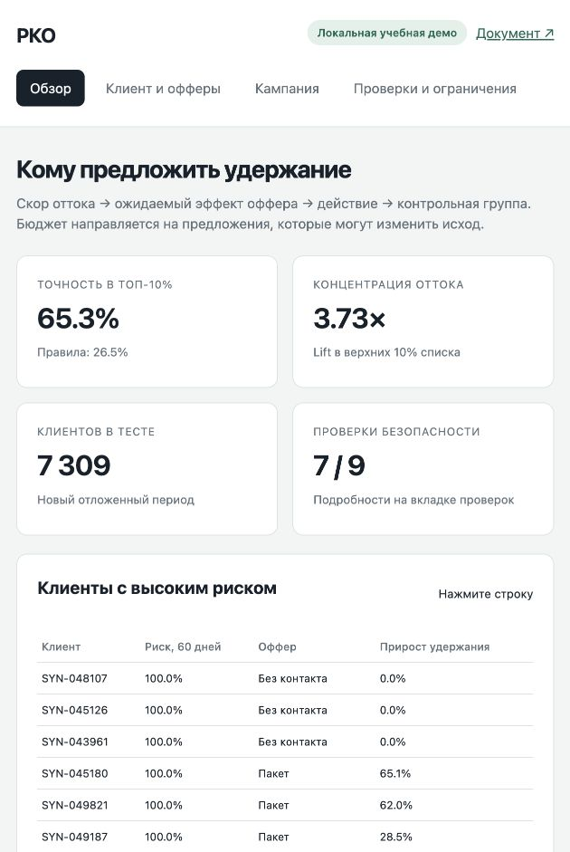

# Gate 3 · Удержание клиентов РКО

Учебный проект по управлению продуктами машинного обучения: прогноз оттока → оценка эффекта оффера → действие → контрольная группа. Кейс B, продолжение Gate 2.

## Проверяющему: с чего начать

| Порядок | Материал | Что проверяется |
|---|---|---|
| 1 · 5–10 минут | [Основной документ Gate 3](gate3-prototype.md) | Все пункты A–G, отправная точка, метрики, ресурсы, экономика, самооценка и рекомендация |
| 2 · 3–4 минуты | [Ноутбук с выполненными ячейками](prototype/demo.ipynb) | Пять сценариев прототипа, включая ошибку; сохранённые результаты видны прямо в GitHub |
| 3 · 2 минуты | [Сводка результатов](docs/results.md) | ML против правил, экономика, задержка, ограничения и ссылки на первичные расчёты |
| 4 · при необходимости | [Запуск интерактивной демо](prototype/README.md#запуск) | Пересчёт клиента и бюджета на своём компьютере |

Для проверки документа и сохранённых результатов устанавливать зависимости не нужно. В ноутбуке откройте вкладку **Preview**. Если GitHub не отрисовал ноутбук, используйте документ, сводку и [таблицу исходных результатов](prototype/results/).

## Результат

- Точность в верхних 10% списка: **65,3% против 26,5%** у правил; отложенная выборка — 7 309 клиентов.
- При одинаковом оффере: **4,69 ₽ дополнительной выручки на 1 ₽ бюджета** против 4,61 ₽ при отборе только по риску. Гипотеза преимущества в 1,5 раза не подтверждена.
- **11 из 11 программных тестов** пройдены. Из девяти проверок поведения модели пройдены **семь**; открыты сезонность и региональный разрыв полноты.
- Рекомендация: **условный переход к Gate 4**. Основания и условия — в документе.

Основная панель РКО и исследовательские материалы созданы для учебного сценария; отдельный публичный набор UCI проверяется независимо. Происхождение, допущения и границы выводов описаны в [методе](prototype/README.md#метод-и-происхождение).



## Ссылки для сдачи

Готовый список для вставки в форму или сообщение преподавателю: [docs/submission-links.md](docs/submission-links.md).

## Запуск

Требуется Python 3.12. Из корня клонированного репозитория:

```sh
sh prototype/start.sh
```

Команда установит зависимости, пересчитает эксперимент, выполнит тесты и запустит демо. После появления адреса сервера откройте `http://127.0.0.1:8765`. Этот адрес работает на компьютере, где запущен сервер; опубликованного сервиса на GitHub нет.

[Подробная инструкция](prototype/README.md#запуск) · [Сценарий показа на 3–4 минуты](prototype/DEMO.md)

## Карта репозитория

| Путь | Содержание |
|---|---|
| [gate3-prototype.md](gate3-prototype.md) | Основной документ для оценки |
| [docs/](docs/) | Сводка результатов, ссылки для сдачи и снимок интерфейса |
| [prototype/demo.ipynb](prototype/demo.ipynb) | Выполненный демонстрационный ноутбук |
| [prototype/](prototype/) | Код, интерфейс и инструкция запуска |
| [prototype/results/](prototype/results/) | Метрики, экономика, проверки безопасности, список кампании и протокол верификации |
| [prototype/data/](prototype/data/) | Панель, срезы, эталон эффектов, исследовательский корпус и публичный набор |
| [prototype/models/](prototype/models/) | Сохранённые модели для запуска без переобучения |
| [prototype/tests/](prototype/tests/) | Программные регрессионные проверки |
| [prototype/research-and-data-plan.md](prototype/research-and-data-plan.md) | Материалы исследования, гайдлайн разметки и план Gate 4 |
| [Источники и предыдущие Gate](docs/sources.md) | Условие задания, инструкция кейсов и предыдущие материалы |
| [PROJECT_CONTEXT.md](PROJECT_CONTEXT.md) | История решений, статус и открытые вопросы проекта |

Данные UCI распространяются по CC BY 4.0; [первичный источник и контрольная сумма](prototype/data/public/iranian_churn.source.json) включены в репозиторий. Локальные окружения, временные файлы и кэши в Git не включаются.
